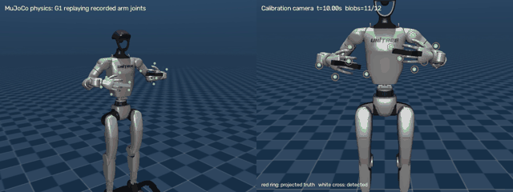

# MuJoCo check: real G1 model, rendered camera

The benchmark generates marker pixels straight from a formula, using a simplified 7-joint arm. This folder checks what changes with a more realistic setup:

- the real Unitree G1 model;
- physics simulation;
- markers detected from rendered images.



Full video: [g1_sim.mp4](g1_sim.mp4). Left is an overview. Right is the calibration camera: red rings are projected true marker positions, white crosses are blobs detected in the image.

## Setup

- **Robot:** Unitree G1 from [MuJoCo Menagerie](https://github.com/google-deepmind/mujoco_menagerie/tree/main/unitree_g1). The pelvis is fixed in place, and gravity is on.
- **Motion:** the recorded arm joints from `example_a/capture_37` (810 frames, 27 s). They are fed as targets to the model's position controllers, so the arms are driven by physics, not posed directly. Legs and waist are held at 0.
- **Targets:** a 6-marker target on each wrist. The marker layout is the same as `MARKERS` in the benchmark's `camera_model.py`.
- **Camera:** fixed in front of the robot, 640×480, with no lens distortion. Markers are found with an HSV colour threshold and connected components (OpenCV).

## First results

| Metric | Value |
| --- | --- |
| Joint tracking error, simulated vs recorded | mean 0.12°, max 0.6° |
| Markers detected | 93.3% |
| Frames with at least one marker hidden by the hand or body | 65.8% |
| Detection error vs projected truth | mean 0.82 px, P95 2.17 px, max 4.80 px |

The benchmark assumes at most 0.3 px of observation noise and treats occlusion as a per-record subset. In this render, the detection error alone reaches the 2 px pass threshold at P95, and most frames have a marker hidden.

This is only a first check, with three caveats:

- The resolution is half the benchmark's (640×480 vs 1280×960).
- Partly hidden markers can shift a blob's centroid.
- The calibration solver has not been run on these detections yet.

## Next

- Rerun at 1280×960.
- Feed the detected blobs into the reference solver and measure the final calibration error.
- Add lens distortion and motion blur.

## Run

```sh
pip install mujoco imageio imageio-ffmpeg opencv-python scipy
git clone --depth 1 https://github.com/google-deepmind/mujoco_menagerie menagerie
python simulate.py     # writes g1_sim.mp4 and g1_sim_log.json, about 8 min on CPU
python analyze.py g1_sim_log.json
```

Run these from this folder. The G1 model files are not included here; they are downloaded from MuJoCo Menagerie under its own license. On a headless Linux machine, prefix the simulate command with `MUJOCO_GL=glfw xvfb-run -a`.

The code was written with AI assistance. I chose the setup, checked the outputs, and wrote this summary.
